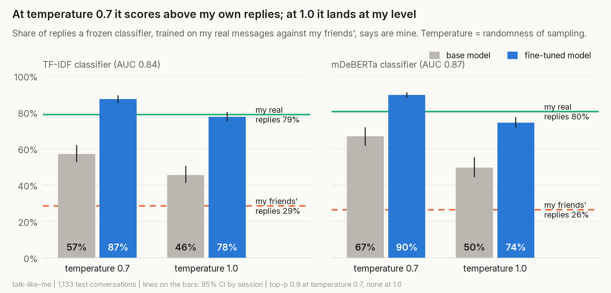
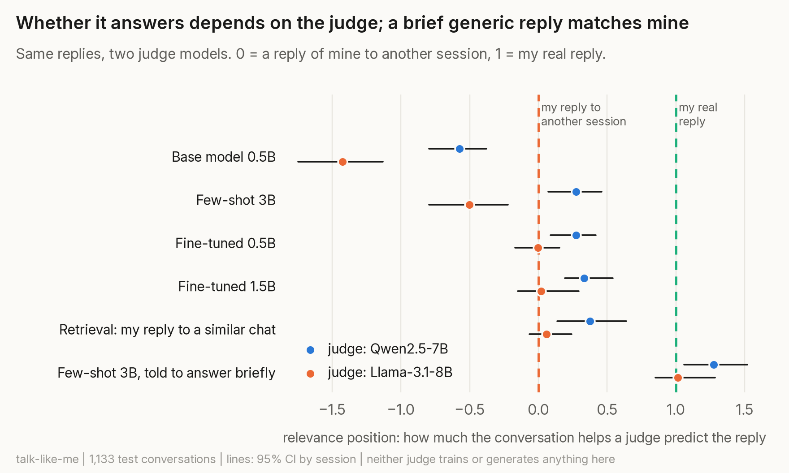
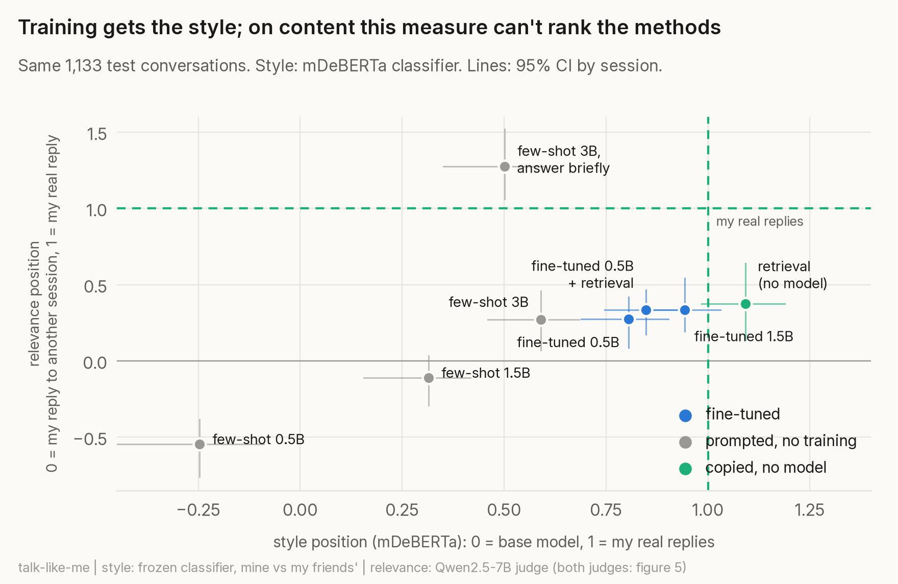
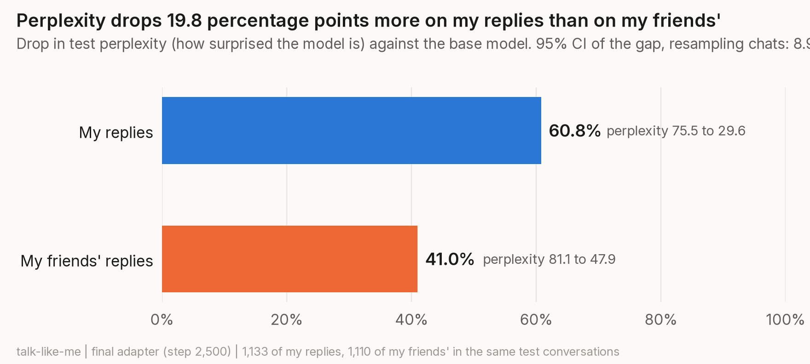
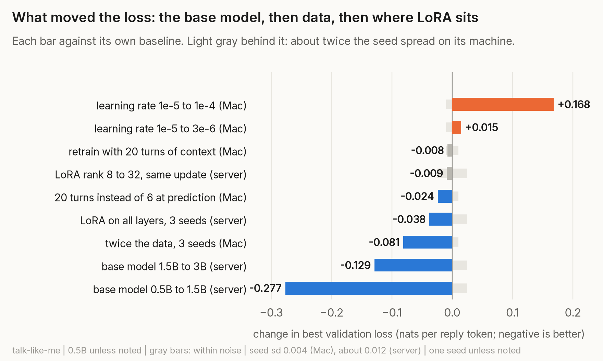

# talk-like-me

### Can a 0.5B model learn to text like me from four months of my WhatsApp chats? And how would I know?

I fine-tuned Qwen2.5-0.5B with LoRA on about 5,400 of my own WhatsApp replies, on a MacBook with [MLX](https://github.com/ml-explore/mlx). To make this as robust as possible, I measured everything against a control group, with confidence intervals and a prediction written before each run. Results show that the adapter learned something specific to how I write, beyond informal Spanish chat. It sounds like me to a classifier trained on my messages, though it does not demonstrably answer the conversation better than a reply of mine copied from another conversation, and the measure for that turned out to reward generic on-topic replies. Oh, and along the way, I found and quantified a loss bug in mlx-lm.

| | Answer | Key number |
|---|---|---|
| Did it learn **me**, or just informal chat? | Yes, in the chats it was trained on | perplexity drops 19.8 percentage points more on my replies than on my friends' in the same conversations (CI 8.9 to 26.0). It holds after matching length, without repeated replies, across seeds, and in a symmetric test where an adapter trained on a friend learns *them* |
| Does it **sound** like me? | **Mostly** | a frozen classifier labels 78% / 75% of its replies as mine (TF-IDF / mDeBERTa); my real replies 79% / 80%, the base model 46% / 50% |
| Does it **answer** the conversation? | **Not demonstrably** | relevance position 0.27 (CI 0.09 to 0.42) with one judge model, 0.00 (CI -0.17 to 0.15) with another |
| Is fine-tuning **worth it**? | **For the style, yes. For the content, the measure can't tell** | no prompt gets close on style; on content an untrained 3B told to answer briefly matches my real replies |

**Also measured:** memorization (an invented code planted in 4 training replies ranks first of 1,001 candidates; the 0.5B writes it out only at 16 to 32 repetitions) and what lowers the loss (a bigger base model most, then more data, then LoRA on every layer; a lower learning rate, a longer context window and a bigger LoRA rank don't help).

**Terms.** *Session*: a stretch of one chat without a 3-hour silence; train, validation and test are split by whole sessions. *Chat*: everything with one person. *Perplexity*: how surprised the model is by the real reply (its loss in nats, exponentiated). *Signal*: how much more the perplexity drops on my replies than on my friends'. *Style position*: where a set of replies falls between the base model (0) and my real replies (1) for the classifier. *Relevance position*: how much the conversation helps a judge model predict a reply, between a reply of mine to another session (0) and my real reply (1).

**Limits that matter.** One person and four months of chats. Test sessions come from the same chats as training (other sessions, never the same conversation), so this shows the model learned me with people it saw, not with new people. 67 test sessions from 18 chats, 3 of them with 63% of my test replies: the intervals resample whole chats where it matters, and are still optimistic. Style is judged by a classifier, not by people. "Answering" is judged by models that can't know whether a reply is true and that disagree on the adapter. Later experiments ran on a second machine (a home GPU server), compared only within themselves; model size and memorization on the 1.5B are one seed.

**How it was written.** The questions, the predictions, the decisions and the core evaluation code (the reply-only loss, the bootstrap) are mine. Claude (an AI coding assistant) wrote most of the plumbing and drafted most of the write-ups and notebook conclusions, which I checked against the notebook outputs. How the work was split is in [decision 10](DECISIONS.md).

Links, emails, Spanish phone numbers and the names on my contact list are replaced with placeholders before training. Other details (people outside my contacts, foreign numbers) are not scrubbed, which is one reason the data and the trained adapters never leave my home network ([privacy](docs/privacy.md)). This repo has the code, every decision with the numbers behind it, and aggregated results only.

## The surprising part: more me than me



I trained a classifier to tell my real messages apart from my friends' and froze it. Then I asked it to judge replies written by the base model and by my fine-tuned adapter in the same test conversations. With the usual sampling settings (temperature 0.7, top-p 0.9), it labeled **87% of the adapter's replies as mine, more than my own replies (79%)**.

The model didn't surpass me. Sampling at 0.7 cuts the least likely words at every step, and my rarest habits are exactly those: I write "xd" in 7.6% of my messages, and the model did in 1.6%. What remained was my most typical self, which looks more like "me" to a classifier than I do. Sampling the model as it learned (temperature 1.0) brings the quirks back, and it lands at my level. [How the classifier works and every number.](docs/results.md#7-does-it-sound-like-me-decision-19)

## It sounds like me, but doesn't really answer



A judge model (Qwen2.5-7B, which trains and generates nothing here) scores each reply with and without the conversation before it. The gain is how much the conversation makes the reply easier to predict. A reply of mine taken from a *different* conversation already gets a third of what my real reply gets, because the conversation mostly tells you the register: informal, short, Spanish. The part that means "this reply answers that message" is the band on top. With this judge the adapter covers about a quarter of it; with a judge from another family (Llama-3.1-8B), none. And an untrained 3B told to answer in one short sentence matches my real replies on this measure with both judges: it rewards on-topic generic replies, not what I would say. **It learned how I write; whether it learned anything of what I would say, this measure can't show.** [The measure and its limits.](docs/results.md#8-does-it-answer-the-conversation-decisions-20-22)

## Is fine-tuning worth it?



The obvious alternatives, on the same test conversations and the same evaluation: few-shot prompting of untrained Qwen2.5 0.5B, 1.5B and 3B with 20 of my replies in the prompt, the same recipe on the 1.5B, and plain retrieval (my real reply to the most similar conversation, no model). Only training got the style from a model. The first few-shot prompt was simple and its replies long; a fairer one, with a 64-token cap and an instruction to write one short informal message, doesn't help the style either. On content the picture depends on the judge: with Qwen2.5-7B (the figure) the adapters cover a quarter to a third of the way, with Llama-3.1-8B they sit at the floor, and with both an untrained 3B told to answer briefly matches my real replies (1.27 and 1.01), so this measure rewards on-topic generic replies more than what I would say. [All the numbers.](docs/results.md#9-is-fine-tuning-worth-it-decisions-22-30)

## What it learned, and what limits it



Perplexity is how surprised the model is by the real reply: 30 means, on average, as unsure as picking among 30 equally likely tokens at each step. Most of its drop is the register, and it shows on my friends' messages too. What drops *more* on mine is attributed to me. That signal was half hidden at first by a bug in mlx-lm's evaluation, which in version 0.32.0 counts a padding token in the loss ([ml-explore/mlx-lm#2029](https://github.com/ml-explore/mlx-lm/issues/2029)). Every loss here is computed by hand, on reply tokens only.



A bigger base model is by far the strongest lever, then more data, then putting LoRA on every layer. Retraining with a longer context window and the adapter's rank don't move the loss beyond training noise (three seeds put it at a standard deviation of about 0.004 on the Mac and 0.012 on the server); a lower learning rate is slightly worse and a higher one much worse. A bigger model predicts my replies and my friends' better alike: the part that is specifically mine is indistinguishable at 0.5B, 1.5B and 3B. [All experiments.](docs/results.md)

## Try it on your own chats

```bash
uv sync
uv run python scripts/run.py --whatsapp ~/Desktop/ChatStorage.sqlite --name me --list-chats   # pick chats to leave out
uv run python scripts/run.py --whatsapp ~/Desktop/ChatStorage.sqlite --name me \
    --system-prompt "Eres Ana. Responde como ella en WhatsApp." --names my_contacts.txt --exclude-chats exclude.txt
uv run python scripts/chat.py --adapter runs/me/best
```

One command copies and scrubs the data, splits it by conversation, trains, picks the best checkpoint on validation, and leaves a ready adapter in `runs/me/best/` plus every number in `runs/me/summary.json`. It also takes messages from any source as a `.jsonl`. Training takes a bit over an hour on an M1 Pro for four months of chats, plus the evaluation. [Setup, options and what to expect.](docs/usage.md)

## The story: how one result led to the next

**1. A model that writes like me, measured instead of eyeballed.** I wanted one project in depth that covered fine-tuning, evaluation and inference end to end, on my own laptop. "It sounds like me" is not a metric, so from day one the rule was: write a prediction before every run, and only trust numbers with an interval. ([decisions 1 to 5](DECISIONS.md))

**2. The data had to stay private and still be useful.** WhatsApp's Mac app keeps every chat in one SQLite file, which gave me four months of one-to-one chats. Names, links, emails and phone numbers became placeholders before anything else touched the text. I split by whole conversation, not by message, so a test reply could never show up as context in training. ([data.md](docs/data.md))

**3. First training, first surprise.** The validation loss (as mlx-lm reported it) dropped 42% in 1,000 steps, most of it in the first 200. I had predicted 5% at most. The model wasn't learning *me* that fast: it was learning the register, short lowercase Spanish chat, which is one big easy shift.

**4. So: me, or WhatsApp?** To separate the two I measured the same thing on my friends' replies in the same conversations. Doing that by hand, my loss didn't match mlx-lm's. The library counts a padding token in the loss, which hid more than half of the signal. With the loss fixed, perplexity drops about 20 percentage points more on my replies than on theirs. Matching message length takes away 3 of those points, three seeds move it by about 1, and removing repeated replies barely touches it. The decisive check was symmetric: in one chat, an adapter trained on my friend's replies learns *them* just as mine learns me. ([results 1](docs/results.md#1-did-it-learn-me-or-whatsapp-decisions-12-21-29))

**5. Is it safe?** A secret planted in five training replies ended up first of 31 candidates on the final adapter. A proper dose-response study with 24 codes showed why: the adapter *recognizes* a secret after a handful of repetitions, long before it would *write* it out. That is why the adapters stay private. Splitting by message instead of by conversation makes the test a little easier, though not demonstrably so. ([results 2 and 3](docs/results.md#2-does-it-memorize-private-text-decisions-13-23-27))

**6. Then everything hit the same wall.** Early stopping put the best checkpoint at ~1.9 epochs, and three seeds agreed on it. A lower learning rate got close to the same loss more slowly, a higher one did worse, and 20 turns of context instead of 6 barely helped. I guessed the base model was too small; the data curve said every doubling of data still helps. ([results 4 to 6](docs/results.md#4-how-long-to-train-and-how-fast-decisions-15-16-29))

**7. Does it actually sound like me?** A classifier trained on my real messages said the model was *more* me than me. Chasing that led to the sampler: temperature 0.7 trims my rare quirks and leaves a caricature of my typical self. Sampled as it learned, it is at my level. ([results 7](docs/results.md#7-does-it-sound-like-me-decision-19))

**8. And does it answer?** Sounding like me doesn't mean replying to what was said. Measured against a reply of mine from another conversation, it barely answers. ([results 8](docs/results.md#8-does-it-answer-the-conversation-decisions-20-22))

**9. Was training even needed?** Few-shot prompting doesn't get the style, so yes, for that. For the content, a lookup of my own past replies does as well as any model, and combining the two doesn't help. ([results 9](docs/results.md#9-is-fine-tuning-worth-it-decisions-22-30))

**10. Which lever, then?** I ran each one with a threshold written beforehand. LoRA rank: no. LoRA on every layer: yes, 0.04, confirmed with three seeds. A bigger base model: by far the largest gain in loss (0.28 from 0.5B to 1.5B), but not a demonstrably better answer, and not more of *me*. That is where the project stands: the style is learned; what I would actually say is the open problem. ([results 6](docs/results.md#6-what-limits-the-loss-decisions-18-25-26-28))

## How it was done

| | |
|---|---|
| [docs/data.md](docs/data.md) | Where the data comes from, how it is cleaned and anonymized, sessions, turns and splits |
| [docs/results.md](docs/results.md) | Every experiment with its numbers, controls and caveats |
| [docs/usage.md](docs/usage.md) | Running it on your own chats, all the scripts, what to expect |
| [docs/privacy.md](docs/privacy.md) | What stays private, what the model sees, what is published |
| [DECISIONS.md](DECISIONS.md) | Every decision in order: why, what was discarded, my prediction and whether it held |
| [NOTEBOOK.md](NOTEBOOK.md) | Lab notebook: back-of-the-envelope maths (speed, memory, parameter count) and the prediction written before each run |
| [experiments/](experiments/README.md) | The notebooks where each result was measured, with their outputs, grouped by question with an index |

```
talk_like_me/   shared code: config, the reply-only loss, bootstrap by session
pipeline/       data pipeline: extract, report, clean, build_* (datasets)
scripts/        run.py (one command), train, eval_*, generate, chat, plots, reproduce.sh
experiments/    notebooks and results/*.json (aggregated numbers, no text)
docs/           the details, and figures/
tests/          unit tests on invented data
```

Built with MLX and mlx-lm (Metal on an M1 Pro with 32 GB, CUDA on an RTX 3080 at home), Qwen2.5, scikit-learn and Hugging Face Transformers.

Code under the [MIT License](LICENSE). The data and the trained adapters are not part of this repository and are not published.
