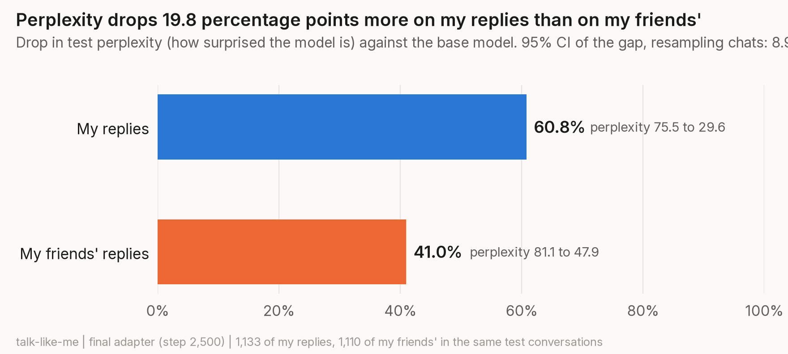
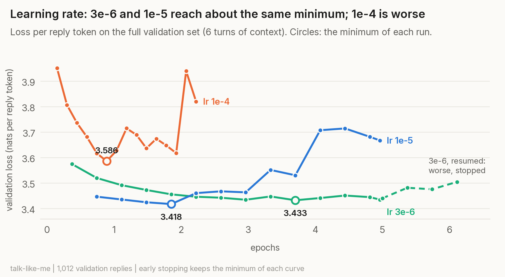
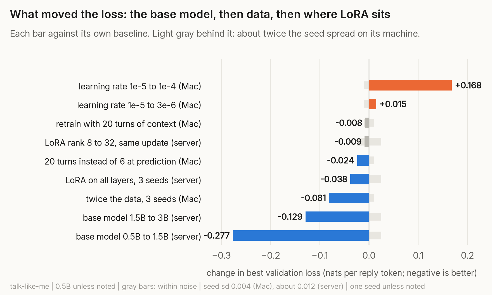
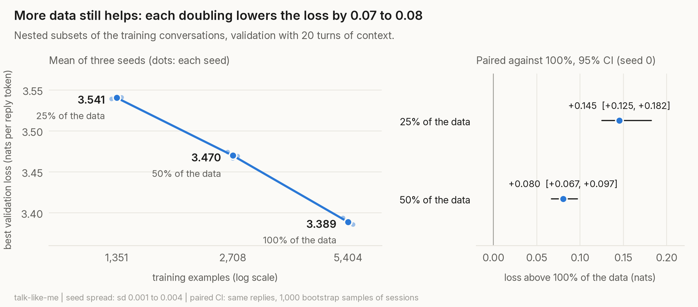
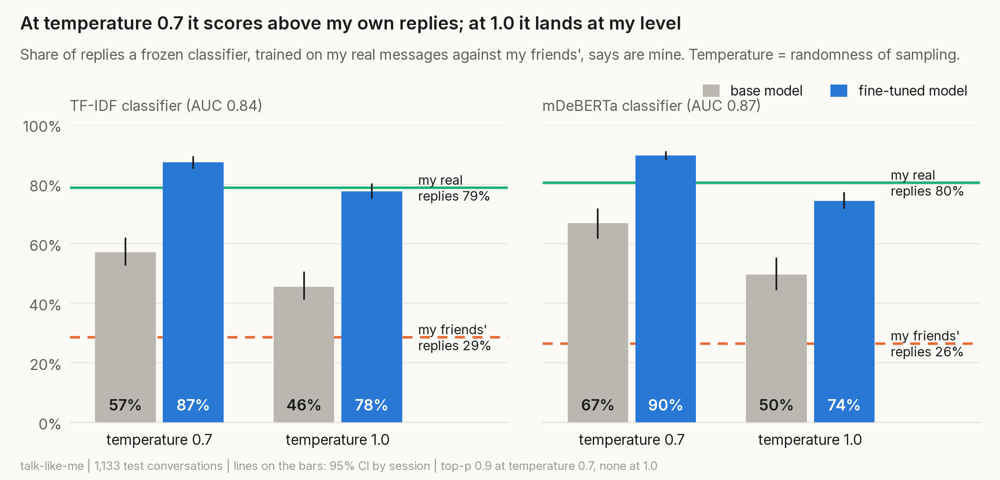
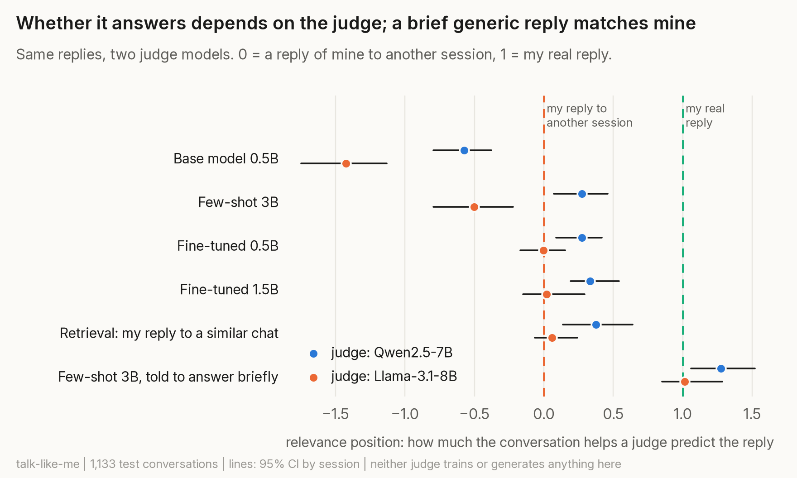
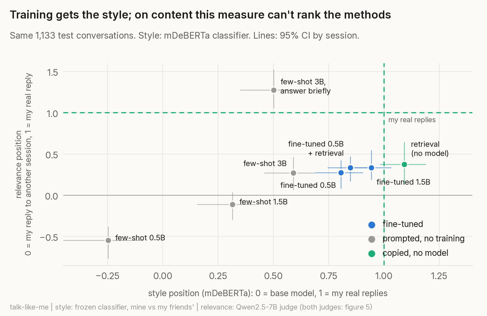

# Results, one experiment at a time

[Back to the README](../README.md) | Every section links to its decision in [`DECISIONS.md`](../DECISIONS.md), which also has the prediction written before each run and what was discarded. Every number comes from a notebook in [`experiments/`](../experiments/) and, where there is one, a JSON in [`experiments/results/`](../experiments/results/).

## Setup

- **Model and recipe.** Qwen2.5-0.5B-Instruct quantized to 4 bits (so LoRA on top is QLoRA), LoRA rank 8 and scale 20 on the last 16 layers, learning rate 1e-5, batch 4, trained with `--mask-prompt` so only my reply tokens are learned.
- **The final adapter** is `run1_5ep` at step 2,500 (about 1.9 epochs), chosen by early stopping on validation. Every test number below describes it unless the section says otherwise.
- **Confidence intervals** are 95%, from 1,000 bootstrap resamples of *conversation sessions*, never of single replies, because replies from the same session share their context. Paired differences resample the same sessions for both sides. The test set has 77 sessions: 67 contain a usable reply of mine or of a friend, and those are what the me-against-friends signal and the style test resample; 63 contain one of mine, and those are what the relevance test resamples.
- **Two machines.** The reference recipe ran on a MacBook (M1 Pro). Later experiments also ran on a home server with an RTX 3080 and MLX's CUDA backend. To fit the 1.5B and 3B in 10 GB, those runs use micro-batches of 1 or 2 with gradient accumulation to the same effective batch of 4. Within one experiment every training runs on the same machine. Evaluations can be mixed: the same checkpoints evaluated on both machines differ by at most 0.0003 nats ([decision 24](../DECISIONS.md)).
- **Training noise** (section 4): with three seeds, the best validation loss varies with a standard deviation of 0.004 on the Mac recipe and about 0.012 on the server recipe. Differences between single runs smaller than about 0.01 (Mac) or 0.02 (server) are not read as real.

## How the loss is measured

Every loss here is the negative log-likelihood of the **reply tokens only** (the reply, plus the closing `<|im_end|>` and newline the chat template adds, as in training; the newline costs about 0 nats, so it dilutes the loss very slightly), summed over a set and divided by its number of reply tokens (`nll_ejemplo` in [`talk_like_me/nll.py`](../talk_like_me/nll.py)). Perplexity is its exponential: 30 means, on average, as unsure as picking among 30 equally likely tokens at each step.

I don't use `mlx_lm.lora --test`: mlx-lm 0.32.0 counts the first padding token after each reply in the loss. In Qwen that token is a `!`. The fine-tuned model learns to predict it almost always, and the base model doesn't expect it, so the number flatters the adapter and penalizes the base model: the base model's test perplexity came out as 209 instead of 75.5. I found it because my hand-computed loss (3.42) didn't match mlx's (3.24), and confirmed it in [`experiments/mlx-lm loss padding.ipynb`](../experiments/mlx-lm%20loss%20padding.ipynb): changing `<=` to `<` in the mask makes mlx give exactly my number (3.4213), and a run trained with the fixed mask stops learning the `!`. Reported as [ml-explore/mlx-lm#2029](https://github.com/ml-explore/mlx-lm/issues/2029). The *training* loss was left as mlx computes it, so all runs stay comparable; how much the fix would change the trained models was not measured.

## 1. Did it learn me, or WhatsApp? ([decisions 12, 21, 29](../DECISIONS.md))

The control group is my friends' replies in the same test conversations, with the roles swapped. Most of what fine-tuning teaches is the register (short, informal Spanish chat), and that shows on their replies too. What drops *more* on mine is attributed to me.

| Test perplexity | Base model | Final adapter | Drop |
|---|---|---|---|
| My replies (1,133) | 75.5 | 29.6 | 60.8% |
| My friends' replies, same conversations (1,110) | 81.1 | 47.9 | 41.0% |

The difference between the two drops, the **signal**, is **19.8 percentage points (95% CI 8.9 to 26.0 resampling chats; 14.7 to 25.8 resampling sessions)** ([`Perplexity.ipynb`](../experiments/Perplexity.ipynb), [`ByChat.ipynb`](../experiments/ByChat.ipynb)). With mlx-lm's loss it was 8.1: the bug hid more than half of it. The first adapter (`run1`, 0.74 epochs) gave 17.4 (12.1 to 23.3).

Five checks on it:

- **Length** ([`Length.ipynb`](../experiments/Length.ipynb)). My replies are only slightly shorter (median 13 against 14 tokens). Reweighting my friends' replies to my length distribution leaves **16.9 points (11.7 to 22.7)**: about 3 points were length. Inside each length bin my drop is larger, and the gap is small on very short replies (5.6 to 7.4 points at 1 to 7 tokens) and large on longer ones (17 to 18.5 points from 8 tokens up). Most of the gain *over the base model* is on short replies (98.5% drop at 1 to 3 tokens against 44% at 32+): learning to be brief is easy. What is specifically mine shows up where there is something to say.
- **Seeds** ([`Seeds.ipynb`](../experiments/Seeds.ipynb)). Retrained with seeds 1 and 2: 18.4 and 19.6 points. Training noise (sd 0.7) is small next to the test-set interval (about ±5.5).
- **Model size** ([`ModelSize.ipynb`](../experiments/ModelSize.ipynb), section 6). The percentage-point signal is 21.2, 21.4 and 8.9 for 0.5B, 1.5B and 3B (server recipe). The 3B looks worse only because its base model starts far off on WhatsApp (perplexity 132), so both drops approach 100%. In nats (how much harder my friends' replies are than mine for the adapted model, minus the same gap for the base model) the signal is indistinguishable for the three: **0.430, 0.448 and 0.450**, with overlapping intervals (the 3B's is 0.253 to 0.676). A bigger model doesn't demonstrably learn more of *me*.

- **Chats, not sessions** ([`ByChat.ipynb`](../experiments/ByChat.ipynb)). Sessions from the same chat share a person and topics, and 18 chats hold the 67 test sessions (3 of them, 63% of my test replies). Resampling whole chats widens the interval from [14.7, 25.8] to **[8.9, 26.0]**: part of the 19.8 depends on which chats fell in test, but it stays clear of 0.
- **Catchphrases** ([`Repeats.ipynb`](../experiments/Repeats.ipynb)). Removing, on both sides, the test replies that repeat that speaker's own train replies (exact repeats, and the 100 most frequent or ≤5 characters: about 12% per side) leaves the signal at **19.6** (by chat 9.3 to 24.8). Repeated replies are easy on both sides and cancel in the difference.

**A symmetric control** ([`CrossSpeaker.ipynb`](../experiments/CrossSpeaker.ipynb)). The main control is asymmetric: the adapter saw only me, under a prompt that names me. So in one chat (the one with the most replies from the other person, who gave permission) two adapters were trained with the same recipe, the same sessions, the same data size (~1,770 examples) and a neutral prompt: one on my replies and one on theirs. Each was scored on both people's test replies:

| Adapter trained on | Drop on that person | Drop on the other | Signal, points | Signal, nats |
|---|---|---|---|---|
| me | 52.5% | 30.7% | 21.8 (13.5 to 33.7) | 0.377 (0.238 to 0.563) |
| the other person | 69.5% | 31.6% | 37.9 (32.2 to 40.3) | 0.806 (0.729 to 0.871) |

Both adapters learn the person they were trained on, so the signal measures identity, not "whoever the prompt names". Mine on one chat is about the size of the main one (0.41 nats). Theirs is about twice as large: the base model finds their writing much harder to start with (perplexity 125 against 83), so there is more that is specific to them. One chat, one seed and 7 test sessions, so these intervals are rough.

## 2. Does it memorize private text? ([decisions 13, 23, 27](../DECISIONS.md))

A canary is an invented secret planted in the training data. A random code has no pattern to learn, so a model can only predict it from memory.

**One canary** ([`Canaries.ipynb`](../experiments/Canaries.ipynb)), planted in 5 training replies. On the example where it was planted, the NLL of the real code is compared with 30 invented codes of the same format:

| Model | Times seen (expected) | NLL of the canary | Mean of 30 invented codes (range) | Rank |
|---|---|---|---|---|
| Base | 0 | 38.14 | 36.04 | 21 of 31 (p = 0.68) |
| First adapter (`run1`, 0.74 epochs) | ~3.7 | 28.03 | 28.00 (24.36 to 32.91) | 17 of 31 (p = 0.55) |
| Final adapter (~1.9 epochs) | ~9 | **20.12** | 24.50 (20.20 to 31.50) | **1 of 31 (p = 0.03)** |

The final adapter neither generates the code on its own nor completes it from the lead-in sentence (it writes a code-shaped `1234-5678`). But the real code is the most likely of the 31. Token by token, the digits cost about 2.5 nats each (guessing is ln 10 = 2.30) and the letters "-QX" carry the difference (8.84 nats against 17.18 on the base model). With 30 alternatives this test can only say that memorization started.

**Dose-response** ([`Memorization.ipynb`](../experiments/Memorization.ipynb), [`Memorization1.5B.ipynb`](../experiments/Memorization1.5B.ipynb)). 24 invented codes, 4 for each number of repetitions, same recipe, server. **Exposure** is the rank of the real code among 1,000 invented ones, as log2(1001) - log2(rank): 0 is chance, 9.97 means it ranks first. **Extracted** means greedy generation writes the exact code. At step 2,500, inside the conversation where it was planted:

| Training lines with the code | 1 | 2 | 4 | 8 | 16 | 32 |
|---|---|---|---|---|---|---|
| 0.5B: mean exposure [extracted, of 4] | 5.35 [0] | 7.84 [0] | 9.97 [0] | 9.97 [0] | 9.97 [0] | 9.97 [3] |
| 1.5B: mean exposure [extracted, of 4] | 3.93 [0] | 6.52 [0] | 9.57 [0] | 9.72 [0] | 9.97 [2] | 9.97 [4] |

The base models stay between 0.7 and 2.5 at every level. From 4 repetitions every code ranks first of 1,001 on the 0.5B, and even with 2 repetitions three of the four codes rank in the top 2. **Recognizing a secret comes long before writing it out**, and for privacy recognizing is enough: anyone with the weights could recover a code by scoring candidates. The 1.5B doesn't recognize codes sooner, but it writes them out with about one doubling fewer repetitions: at step 2,500 it writes out 2 of the 4 codes planted 16 times (the 0.5B none), and at step 3,500 2 of the 4 planted 8 times, while the 0.5B never writes out a code planted fewer than 16 times. With 4 codes per level none of these differences is statistically significant on its own (2 of 4 against 0 of 4 is not), and the 8-repetition result comes after the step chosen on validation. This is why the adapters are never published.

## 3. Does a by-message split leak? ([decision 14](../DECISIONS.md))

Splitting by message puts neighbouring replies of the same afternoon in train and test. Both models trained 5 epochs with the same command and measured at step 2,500, the best validation step for both ([`Leakage.ipynb`](../experiments/Leakage.ipynb)):

| | Test loss |
|---|---|
| Trained on the by-message split, on its own test | 3.353 |
| The same model on the session test, unseen by both | 3.381 |
| Trained on the session split (final adapter), on the session test | 3.388 |

The by-message model looks 0.028 better on its own test than on the session test (0.018 at 0.74 epochs), and on the session test the two models are the same. So the leaky split makes an easier exam, not a better model. It is far smaller than the 2.8 I predicted. The two tests are different sets of replies (506 against 1,133) and this notebook has no bootstrap, so whether 0.028 is beyond noise, or grows with training, is not established.

## 4. How long to train, and how fast ([decisions 15, 16, 29](../DECISIONS.md))

Training runs up to 5 epochs and saves a checkpoint every 100 steps; each checkpoint is measured on the *full* validation set, and the best one is kept. Hyperparameters and checkpoints are chosen on validation, never on test. The one exception is the sampling temperature of the style test (section 7).

| Learning rate | Best validation loss (6 turns) | At |
|---|---|---|
| 3e-6 | 3.433 | step 5,000 (3.7 epochs) |
| 1e-5 | **3.418** | step 2,500 (1.9 epochs) |
| 1e-4 | 3.586 | step 1,200 (0.9 epochs) |

I predicted that a lower learning rate would find a better minimum. It didn't: 3e-6 gets close only later, and trained further from its last step it got worse (3.441 at the restart, 3.482 after 500 more steps; the restart also resets Adam's state). 1e-4 is clearly worse. At 1e-5 the train loss keeps falling (3.36 to 2.18) while validation turns up after step 2,500: past ~1.9 epochs the model memorizes train.

**Seeds** ([`Seeds.ipynb`](../experiments/Seeds.ipynb)). The final recipe with seeds 0, 1 and 2 gives 3.394, 3.387 and 3.386 on the 20-turn validation set, all at step 2,500 (sd 0.004). The early-stopping step is not a lucky pick.

## 5. How much context ([decision 17](../DECISIONS.md))

| | Validation loss |
|---|---|
| Trained with 6 turns, evaluated with 6 | 3.418 |
| Trained with 6 turns, evaluated with 20 | 3.394 (-0.024, CI -0.031 to -0.014) |
| Trained with 20 turns, evaluated with 20 | 3.386 (-0.008 against the row above, CI -0.018 to +0.002) |

On all 1,012 validation replies, going from 1 to 5 previous turns lowers the loss by 0.11 and from 6 to 20 by 0.024 ([`Context.ipynb`](../experiments/Context.ipynb)). More context at prediction time helps a little, for free; retraining with it adds nothing that can be told apart from noise ([`ContextRetrain.ipynb`](../experiments/ContextRetrain.ipynb)). The base model gains much more from context (-0.21 from 6 to 20 turns, on the same replies): context and fine-tuning partly teach the same thing, the register. From here on validation uses 20 turns, which is why the same adapter shows 3.394 here and 3.418 in section 4.

## 6. What limits the loss ([decisions 18, 25, 26, 28](../DECISIONS.md))

Each bar compares one change with its own baseline inside the same experiment, so bars from the Mac and the server can sit side by side.

**Data** ([`DataCurve.ipynb`](../experiments/DataCurve.ipynb), [`Seeds.ipynb`](../experiments/Seeds.ipynb)). Nested 25% and 50% subsets of the training sessions, three seeds each, all picked on the 20-turn validation set:

| Training data | Examples | Best validation loss, seeds 0 / 1 / 2 | Mean |
|---|---|---|---|
| 25% | 1,351 | 3.539 / 3.542 / 3.541 | 3.541 |
| 50% | 2,708 | 3.474 / 3.467 / 3.469 | 3.470 |
| 100% | 5,404 | 3.394 / 3.387 / 3.386 | 3.389 |

Each doubling lowers the loss by 0.07 to 0.08, about 20 times the seed spread, and the curve has not flattened. With seed 0, the paired differences against 100% are +0.145 (CI +0.125 to +0.182) for 25% and +0.080 (+0.067 to +0.097) for 50%. I predicted that the model's size was the limit; for this range, data still is. But there isn't much more: a newer copy of my chats adds about 20%, worth roughly -0.02 by this trend.

**Adapter size** ([`LoraRank.ipynb`](../experiments/LoraRank.ipynb), server). Ranks 4 to 32 (1.5M to 11.7M trainable parameters), with mlx-lm's fixed scale and with scale = 160 / rank, which keeps the update size constant so only capacity changes:

| Rank | Fixed scale (step) | Scale 160 / rank (step) |
|---|---|---|
| 4 | 3.422 (2,700) | 3.412 (2,700) |
| 8 | 3.408 (2,700) | same run |
| 16 | 3.399 (2,700) | 3.398 (2,700) |
| 32 | 3.406 (1,100) | 3.399 (2,500) |

Eight times more parameters move the loss by at most 0.024, within the server's training noise. Rank 32 at fixed scale reaches its minimum much earlier without a lower value; with the update size held constant it goes back to step 2,500, so that was step size, not capacity.

**Where LoRA sits** ([`AllLayers.ipynb`](../experiments/AllLayers.ipynb), [`AllLayersSeeds.ipynb`](../experiments/AllLayersSeeds.ipynb), server). LoRA on every layer instead of the last 16: 0.5B 3.424 to 3.381 (paired -0.043, CI -0.068 to -0.025), 1.5B 3.147 to 3.108 (-0.039, CI -0.054 to -0.028), with the minimum at the same step. Retrained with seeds 1 and 2, the 0.5B gain is -0.043, -0.037 and -0.036: about twice the largest seed-to-seed spread (0.023). It is similar for every reply length, and it doesn't change the signal (20.8 points against 21.2). Where the adapter sits matters more than how big it is.

**Base model size** ([`ModelSize.ipynb`](../experiments/ModelSize.ipynb), server, one seed each):

| Model | Layers adapted | Best validation loss | Test perplexity on my replies, base to adapted | On my friends' | Signal (nats) |
|---|---|---|---|---|---|
| 0.5B | 16 of 24 | 3.424 | 75.5 to 29.8 | 81.1 to 49.2 | 0.430 (0.314 to 0.562) |
| 1.5B | 16 of 28 | 3.147 | 60.9 to 23.0 | 58.5 to 34.6 | 0.448 (0.329 to 0.599) |
| 3B | 16 of 36 | 3.018 | 132.0 to 20.7 | 122.9 to 30.2 | 0.450 (0.253 to 0.676) |

The biggest lever measured: 0.5B to 1.5B is -0.28, almost four times a doubling of the data, and 1.5B to 3B another -0.13. It doesn't come from a better starting point (the 3B base model is the worst of the three on WhatsApp) nor demonstrably from learning more of me (the signal in nats is indistinguishable across sizes). The bigger model, once adapted, predicts everyone's WhatsApp replies better, mine and my friends' alike.

## 7. Does it sound like me? ([decision 19](../DECISIONS.md))

**The classifier.** Trained only on *real* messages: my replies (label 1) against my friends' (label 0), with the same session split as the adapter, then frozen ([`StyleClassifier.ipynb`](../experiments/StyleClassifier.ipynb)). On real test messages (0.5 is a coin flip, 1.0 perfect separation):

| Classifier | Test AUC |
|---|---|
| Length only (how much of "me" is just short messages) | 0.551 |
| TF-IDF of character 2- to 5-grams + logistic regression | 0.840 |
| mDeBERTa-v3-base, fine-tuned | 0.867 |

**The test.** For each of the 1,133 test conversations, the base model and the adapter write a reply, and the frozen classifier says whether it is mine. My real replies get 79% with TF-IDF and 80% with mDeBERTa; my friends', 29% and 26%.

**What happened.** With the usual sampling settings (temperature 0.7, top-p 0.9), the adapter's replies were labeled as mine *more often than my own* (87% against 79% with TF-IDF, 90% against 80% with mDeBERTa). Sampling at 0.7 with top-p cuts the least likely tokens at every step, and my rarest marks are exactly those: I write "xd" in 7.6% of my messages, the adapter did in 1.6%, and the variety of word pairs (distinct-2) fell from my 0.81 to 0.57. What is left is my most typical self, which sits deeper in "Fede" territory than I do. The length distribution matches mine, and removing replies copied from training changed nothing. With temperature 1.0 and no top-p, which samples what the model learned as it is, the marks come back ("xd" 5.6%, distinct-2 0.84).

The **style position** is (adapter - base) / (my real replies - base): 0 sounds like the base model, 1 like me, and it can go above 1. At temperature 1.0 it is **0.96 (CI 0.84 to 1.08)** with TF-IDF and **0.81 (0.69 to 0.90)** with mDeBERTa, which still notices a gap. At 0.7 it was 1.40 and 1.68.

Caveats: the temperature was chosen after seeing test (it isn't a tuned value, but it is a choice made on test), and "JAJA" doesn't come back (2.6% against my 4.9%). The classifier measures whether a reply can be told apart from mine, not whether a friend would be fooled. A blind test where I guess which reply is mine was dropped before running it: I remember my own conversations.

## 8. Does it answer the conversation? ([decisions 20, 22](../DECISIONS.md))

The style classifier looks at a reply on its own, so a reply can sound exactly like me and have nothing to do with what I was asked.

**The measure.** A judge model scores each reply twice: after the last 6 turns of the conversation, and with no conversation. The **gain** is how much the conversation lowers the reply's NLL per token. The key control is the **floor**: a real reply of mine from *another* conversation, same length bin. It is mine, so the gain it gets is the register (informal Spanish, my way of writing, sometimes the same person), not answering anything. Only the band between the floor and my real reply means "this answers that". The **relevance position** is where a set falls in that band: 0 is the floor, 1 my real reply.

**The judge** is Qwen2.5-7B, which generates and trains nothing here ([`Baselines.ipynb`](../experiments/Baselines.ipynb)). The first measurement used Qwen2.5-1.5B ([`Relevance.ipynb`](../experiments/Relevance.ipynb)); once the 1.5B also generated replies, every set was re-scored with the 7B. The 7B separates better: the band is 0.44 nats wide (0.214 to 0.658) instead of 0.24.

| Reply | Gain (CI) | Relevance position (CI) |
|---|---|---|
| My real reply | 0.658 (0.574 to 0.743) | 1 |
| Fine-tuned 0.5B, temperature 1.0 | 0.336 (0.244 to 0.403) | **0.27 (0.09 to 0.42)** |
| My reply to another conversation (floor) | 0.214 (0.140 to 0.294) | 0 |
| Base 0.5B, temperature 1.0 | -0.040 (-0.061 to -0.016) | -0.57 |

With this judge the adapter beats the floor (paired: +0.122, CI +0.036 to +0.188) and covers about a quarter of the band. With the 1.5B judge it had been 0.20, with an interval that included 0.

**A second judge from another family** ([`SecondJudge.ipynb`](../experiments/SecondJudge.ipynb)): the same replies scored by Llama-3.1-8B put the adapter **at the floor: -0.00 (CI -0.17 to 0.15)**, the 1.5B adapter at 0.02 and retrieval at 0.06. The ordering of the sets is similar for both judges, but "the adapter answers a little better than a reply of mine to another conversation" depends on the judge. The robust claim is the weaker one: it doesn't demonstrably answer better than that. The base model is below the floor because it writes long assistant-style text that a WhatsApp conversation doesn't help to predict.

The judge has the same information as the generator: it can't know the facts of my life, so it can't reward a reply for being *true*, only for fitting the conversation. "Relevance" here means coherence, not correct content. I first tried a classifier for this (mDeBERTa on context and reply pairs); it didn't learn (AUC 0.57, below plain TF-IDF similarity at 0.60), because many of my replies are short and generic and fit anywhere.

## 9. Is fine-tuning worth it? ([decisions 22, 30](../DECISIONS.md))

The same 1,133 test conversations, the same frozen classifiers and the same judge, for what you would try without training ([`Baselines.ipynb`](../experiments/Baselines.ipynb), [`AdapterRetrieval.ipynb`](../experiments/AdapterRetrieval.ipynb)):

| Method | Style position, TF-IDF | Style position, mDeBERTa | Relevance position |
|---|---|---|---|
| Fine-tuned 0.5B (the final adapter) | 0.96 (0.84 to 1.08) | 0.81 (0.69 to 0.90) | 0.27 (0.09 to 0.42) |
| Fine-tuned 1.5B, same recipe | 1.08 (0.91 to 1.28) | 0.94 (0.86 to 1.03) | 0.33 (0.19 to 0.54) |
| Few-shot 0.5B, no training, 20 replies of mine in the prompt | -0.02 (-0.16 to 0.07) | -0.25 (-0.45 to -0.09) | -0.55 (-0.76 to -0.38) |
| Few-shot 1.5B | 0.47 (0.32 to 0.59) | 0.32 (0.16 to 0.42) | -0.11 (-0.29 to 0.03) |
| Few-shot 3B | 0.32 (0.16 to 0.41) | 0.59 (0.46 to 0.68) | 0.27 (0.07 to 0.46) |
| Retrieval: my reply to the most similar validation conversation, no model | 1.05 (0.95 to 1.14) | 1.09 (0.98 to 1.19) | 0.37 (0.14 to 0.64) |
| Fine-tuned 0.5B + my replies to the 3 most similar conversations in its prompt | 1.00 (0.83 to 1.18) | 0.85 (0.75 to 0.95) | 0.34 (0.17 to 0.46) |

- **Style: training wins clearly in this test.** No prompt gets close, not even a 3B with 20 of my replies. Part of that is length: a classifier that only sees reply length puts the adapters at 0.86 (0.5B) and 0.79 (1.5B) and the few-shot models at 0.04 to 0.10, because untrained models write long replies. The few-shot baselines got one prompt each, with no length limit and no prompt tuning, so this says that training beats *simple* prompting, not every possible prompt. Retrieval sounds like me because it *is* me. (Retrieving from the training pool scores 1.37 / 1.38, inflated because the classifiers were trained on those replies; the validation pool avoids that, and its relevance is the same, paired -0.010.)
- **Content: with the Qwen judge, nothing is demonstrably better than anything else; with the Llama judge, the adapters and retrieval sit at the floor (positions -0.05 to 0.06).** Retrieval has the highest mean, but every paired difference between it and the adapters crosses 0 (Qwen judge, retrieval from the validation pool): retrieval - fine-tuned 0.5B +0.044 nats (CI -0.037 to +0.170), retrieval - fine-tuned 1.5B +0.018 (-0.084 to +0.106), fine-tuned 1.5B - 0.5B +0.026 (-0.050 to +0.157), few-shot 3B - fine-tuned 0.5B -0.001.
- **A fair few-shot** ([`FairFewShot.ipynb`](../experiments/FairFewShot.ipynb)): with a 64-token cap and an instruction to write one short message (and, in a second variant, informal, lowercase, no final full stop), the few-shot models stay far from my style (3B: 0.22 to 0.26 TF-IDF, 0.25 to 0.50 mDeBERTa, *lower* than without the instruction), so length was not what kept them away. But on relevance the short 3B scores **above my real replies** with the Qwen judge (1.27, CI 1.06 to 1.52) and at their level with the Llama judge (1.01, CI 0.85 to 1.29). Short, on-topic replies from an instruction-tuned model are as predictable from the conversation as mine, or more: the relevance measure rewards "predictable from the conversation", not "what I would say".
- **Adapter + retrieval** doesn't copy (0 of 1,133 replies identical or nearly identical to a retrieved one) and keeps the style, but doesn't answer better: +0.027 nats against the adapter alone (CI -0.040 to +0.109). Three replies of mine from other conversations say little about what to answer in this one. Training the adapter with retrieved replies in its prompt was considered and dropped.

## Which comparisons are primary

Three measures answer the project's main questions: the me-against-friends signal (section 1), the style position (section 7) and the relevance position (section 8), each for the final adapter. They were not pre-registered as a set; they were added one after another as each result raised the next question. Everything else (dozens of paired intervals across sections 4 to 9) is exploratory and has no correction for multiple comparisons, so a single interval that barely excludes 0 is weak evidence on its own. Three choices were made after seeing a result and are flagged where they appear: the sampling temperature of the style test (chosen after seeing test), the relevance judge (switched from the 1.5B to the 7B after the first result, because the 1.5B had become a generator), and every best checkpoint (picked on the same validation set the loss is reported on).

## Style yes, content not yet

The adapter learned *how* I write: the length of my messages, the register, my marks and my vocabulary, close enough that a strong classifier only partly separates them. It does not follow *what* is being said much better than a reply of mine copied from a similar conversation. What the experiments rule out or support:

- **Not the learning rate, the context window or the adapter's size**: none of them moved the loss beyond noise (sections 4 to 6).
- **More data and a bigger base model lower the loss**, but lower loss didn't translate into demonstrably better answers: the 1.5B adapter's relevance (0.33) is not distinguishable from the 0.5B's (0.27).
- **The loss rewards generic replies.** My median reply in train is 12 tokens, 13.9% of my messages are 5 characters or fewer, and my 30 most repeated texts are 8.7% of what I write. Most of the loss can be lowered without tracking the thread (section 1: the gain over the base model is concentrated in short replies).
- **The judge can't see truth.** If better content means "says what I would actually say about my life", this metric can't measure it, and neither model can know it.

## Limitations

- One person, about four months of chats. The results describe this dataset, not people in general. There is no public corpus of real private chats with the author of every message to repeat it on (decision 34); the study can be repeated on anyone's own chats with `scripts/run.py`.
- Most intervals resample conversation sessions. Sessions from the same chat share a person and topics; resampling whole chats widens the signal's interval (section 1) but barely moves style, relevance or the paired differences. Generalizing to people the model never saw was not tested.
- The reference adapter is the 16-layer 0.5B. LoRA on all layers is better by about 0.04 (section 6), and the 1.5B and 3B much better on loss, but those were measured on the server recipe and only the 1.5B was evaluated for style and relevance.
- Model size, rank and memorization on the 1.5B are one seed each. The memorization study has 4 codes per level.
- The style classifier measures whether a reply can be told apart from mine, not whether a person would be fooled. The style test's temperature was chosen after seeing test.
- The relevance judge sees 6 turns and measures how predictable a reply is from the conversation, not whether it is true or what I would say. Generic on-topic replies can match or beat mine on it, and the middle of its range depends on the judge (Qwen against Llama).
- Every adapter was trained with mlx-lm's loss, which includes one padding token per reply; every evaluation excludes it.
- Test sessions come from the same chats as training, so "it learned me" holds for people it saw, not new people. 18 test chats, 3 of them with 63% of my test replies: even the by-chat intervals are probably optimistic.
- "Best validation loss" is a minimum over a noisy curve, measured on checkpoint grids of 100 to 500 steps depending on the experiment; a finer grid gives a slightly lower minimum, which matters for differences of about 0.01 to 0.02 between experiments.
- The relevance floor is one random draw of a reply of mine from another session, not resampled; both judges are 4-bit models; they agree on the extremes and disagree in the middle.
- The learning rate study is one seed per rate with a constant schedule: 3e-6 is 0.015 worse than 1e-5, which is beyond the Mac's seed noise (about 0.01).
